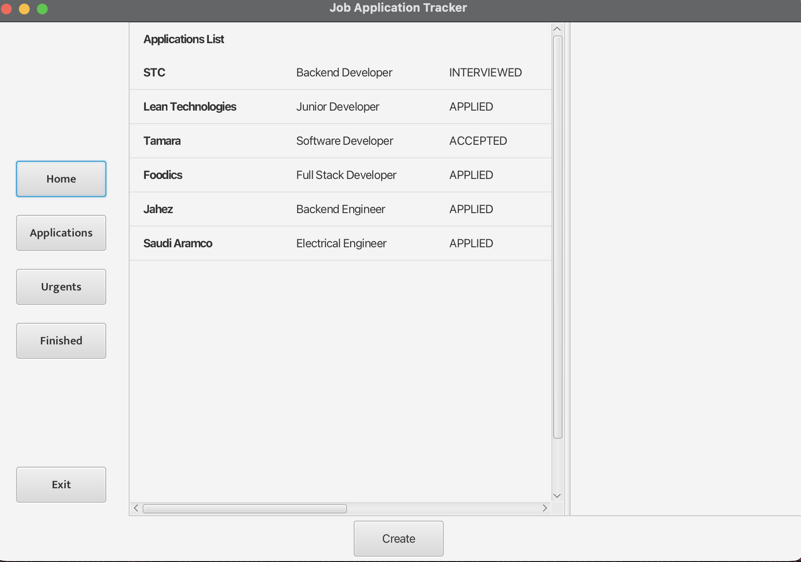
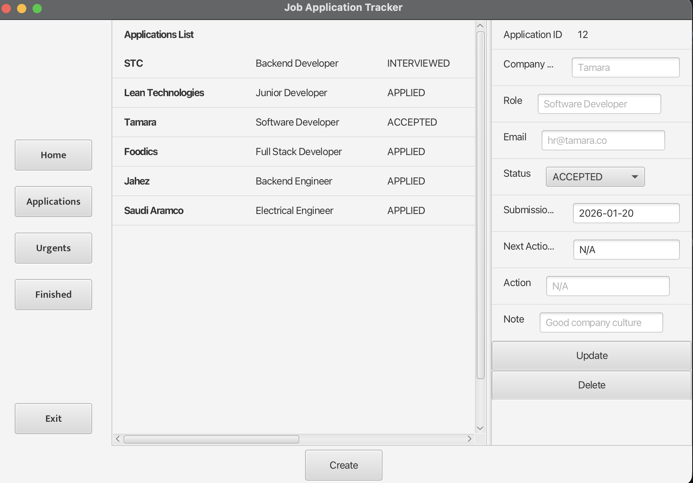
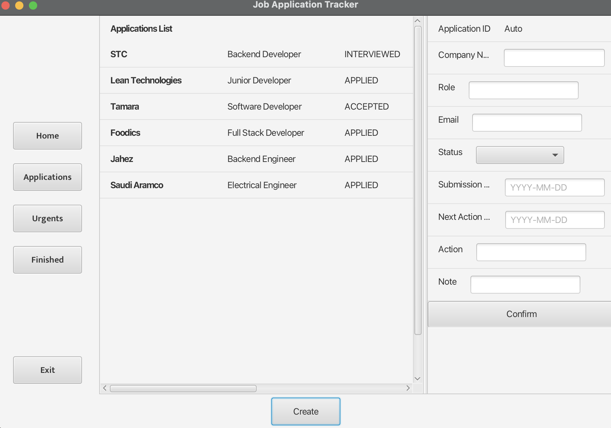

# job-application-tracker

## What is this?
A desktop application for students to track job applications, monitor urgent deadlines, and manage application statuses.

## Features
Implemented several features which is
- Creating application
- Deleting application
- Updating each application's variable
- Displaying all applications
- Monitoring urgent and missed deadlines applications
- Displaying Finished applications
## Tech Stack
Technologies used

- MySQL to write database and store applications
- Used SQL connection to interact with database through dao
- Programming Language used is Java
- For UI, I used JavaFX library
- Used IntelliJ IDEA to write the program
- Used GitHub commits to keep track of my progress
- Used Scene Builder to outline my program and transferred to fxml language
## Architecture
This Software used similar to MVC (Model-View-Controller) approach, so it divided into four layers that communicate
with each other.
the four layers is
- **dao** (data access object) files are responsible for only accessing and manipulating the database.
- **model** files are responsible for the data logic implementing the database tables structure.
- **service** files are responsible for implementing the business logic and ensure that request is meeting the requirements.
- **ui** files are acting like controllers of the page distribution like buttons, table list, etc.
## How to Run
1. Clone the repository
2. Create MySQL database using `src/main/resources/schema.sql`
3. Create `src/main/resources/config.properties` with your credentials
4. Download JavaFX SDK 21 from gluonhq.com
5. Configure VM options in IntelliJ
6. Run `MainApp.java`
## Screenshots

## What I Learned
I have learned lots of thing building this small software
- I learned efficient file communication ui,service,dao,model to make my code readable and easy to edit and implement new features
- I learned proper commit in my GitHub repository to keep track of my code and how to deal with .gitignore file.
- I learned to create a file called config.properties to store sensitive information and put in .gitignore file, so I use my information in my code without violating the security.
## Future Improvements
I mainly created this project, so I can keep improving it with new technology I will learn.
- I want to implement spring boot framework to this project.
- I want to implement proper UI/UX to make my app easy and fun to use
- I want to implement Postgres SQL. 
- I want to implement REST API.